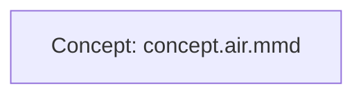

# AIRFlow

AIRFlow (AI Routing Flow) describes AI-assisted software development workflows
with Mermaid diagrams. Each `.air.mmd` file is the single source of truth for
both the visual viewer and AI agents. The viewer fetches the original file at
runtime; no workflow definitions are embedded in HTML or JavaScript.

AIRFlow is a read-only online viewer, not an editor. Source files can be viewed,
copied and downloaded; changes must be made to the original files in the repository.
It is specifically for AI software development workflows: the diagrams describe
stages, decisions, feedback loops and human approval gates for AI-assisted work.
AIRFlow visualizes that process; it does not run agents or execute workflow steps.

## Open a workflow

- Default workflow: `airflow/` or `airflow/index.html`
- Named workflow: `airflow/index.html?flow=project`
- Another workflow: `airflow/index.html?flow=issue`

Choose a workflow from the navigation tree on the left. Branches can be expanded
and collapsed; the current workflow is highlighted. On narrow screens the
collapsible navigation appears above the diagram. There is no name-entry field.

The tree is fetched from `index.json` next to `index.html`. Static hosting does
not provide directory discovery, so new workflows must be listed there to appear
in the tree. Direct `?flow=...` URLs still work for unlisted workflows.

## Navigation index

`index.json` is an array of workflow entries. Each entry has a display `title`,
a safe `flow` name without the `.air.mmd` extension, and optional `children`:

```json
[
   {
      "title": "Project",
      "flow": "project",
      "children": [
         { "title": "Concept", "flow": "concept" },
         { "title": "Definition", "flow": "definition" }
      ]
   }
]
```

Nest `children` to add deeper levels, or add entries to the outer array for
additional roots. Flow names must be unique across the tree and use the safe
filename rules below. The index contains only navigation metadata, never Mermaid
definitions. Each selected workflow is still fetched from `flows/<flow>.air.mmd`.
Changing the tree requires no HTML or JavaScript edits. A missing or invalid
index shows a navigation error without preventing direct workflow URLs from loading.

## Separate workflows

`flows/project.air.mmd` is the orchestrating entry point. Its subroutine nodes
call separate files relative to that source URL; it does not duplicate their
internal steps. Complete each subflow and its required approvals before returning
to Project and following its next edge. The phases are not independently chosen.
Each phase is an independent Mermaid diagram with its own approvals and loops:

| Workflow | Viewer | Raw source |
| --- | --- | --- |
| Project overview | [project](index.html?flow=project) | [project.air.mmd](flows/project.air.mmd) |
| Concept | [concept](index.html?flow=concept) | [concept.air.mmd](flows/concept.air.mmd) |
| Definition | [definition](index.html?flow=definition) | [definition.air.mmd](flows/definition.air.mmd) |
| Design | [design](index.html?flow=design) | [design.air.mmd](flows/design.air.mmd) |
| Implementation, testing and release | [delivery](index.html?flow=delivery) | [delivery.air.mmd](flows/delivery.air.mmd) |

The viewer renders only the selected file. It does not merge or automatically
load referenced workflows. Click an underlined workflow node to open its diagram.
The breadcrumb trail above the diagram navigates back to ancestors. The trail
is stored in the URL, so reloading, sharing and browser Back/Forward preserve it.
Opening a listed workflow directly uses its ancestors from `index.json`; clicking
a tree entry uses that entry's path. Diagram links preserve the traversal path
in the URL, including workflows that are not in the index.
An agent can fetch the overview to discover the
filenames, then resolve each filename relative to the overview's raw URL and
fetch only the phase it needs.

### Link child workflows

In a flowchart, use a node label containing a filename alone, or a description
followed by a colon and filename:



The viewer turns that node into a keyboard-accessible link to `?flow=concept`.
The filename must follow the same safe naming rules as the navigation index;
paths, external URLs and Mermaid JavaScript callbacks are not supported.
The same convention works in child diagrams for deeper trees. Link targets
come from the Mermaid source, not a hardcoded mapping in the viewer. Mermaid
remains in strict security mode. The unmodified source is still available to AI
agents through its raw URL.

Zoom using the buttons or mouse wheel, and drag to pan. With the diagram focused,
use `+` / `-` to zoom, `0` to fit, and arrow keys to pan. Resizing the viewer fits
the diagram again. The theme defaults to the system preference and your choice
is saved locally when storage is available.

Expand Mermaid source to inspect or copy the same source used by the diagram.
Raw source opens the original URL; Download saves the fetched file. Clipboard
access normally requires HTTPS or localhost; when unavailable, the viewer
selects the source for manual copying.

## Add a workflow

1. Create a UTF-8 Mermaid file such as `flows/issue.air.mmd`.
2. Use valid Mermaid syntax, for example `flowchart TD`, followed by your nodes
   and edges. See `flows/concept.air.mmd` for approvals and feedback loops.
3. Add a `{"title": "Issue", "flow": "issue"}` entry to `index.json`, under the
   appropriate parent's `children` or as another root.
4. Open it from the tree or navigate directly to `index.html?flow=issue`.

Names must start with an ASCII letter or digit and contain only ASCII letters,
digits, hyphens and underscores, up to 80 characters. Do not include an extension
or path. The viewer always resolves `flows/<name>.air.mmd` relative to its page.
Path separators, dots and traversal sequences are rejected before fetching.

Edit the Mermaid file to change the diagram; no viewer changes or build step are
needed. Other Mermaid diagram types can use the same file convention. Diagram
links and HTML are restricted by Mermaid's strict security mode.

## Direct AI access

An agent can fetch the original plain-text Mermaid source without loading the
viewer or executing JavaScript:

```text
https://<domain>/airflow/flows/project.air.mmd
https://<domain>/airflow/flows/concept.air.mmd
https://<domain>/airflow/flows/definition.air.mmd
https://<domain>/airflow/flows/design.air.mmd
https://<domain>/airflow/flows/delivery.air.mmd
https://<owner>.github.io/<repository>/airflow/flows/project.air.mmd
```

For example, provide that URL as development context and ask the agent to follow
its stages, approval decisions and feedback loops. The URL serves the original
file, not generated JSON or an HTML copy.

## Use with AI and Copilot

Use the viewer URL for people and the raw Mermaid URL for agents:

| Audience | URL |
| --- | --- |
| Human diagram viewer | `https://vanlangen.org/airflow/?flow=project` |
| AI workflow source | `https://vanlangen.org/airflow/flows/project.air.mmd` |

### Quick setup

1. Download [the standard copilot-instructions.md](copilot-instructions.md).
2. Place it at `.github/copilot-instructions.md` in your consuming repository.
   If that file already exists, merge the instructions instead of replacing it.
3. Commit it with your project and use Copilot with repository instructions enabled.

The file is ready to use: it references the shared Project source and defines
subflow calls, return conditions, human approvals and resuming work. It is a
downloadable template, not an active instruction file for this website repository.
No changes to the viewer or navigation index are needed for consumers.

Open **Get started**, next to the theme switch, for the download and explanation.
Alternatively, **Copy AI reference** fetches that same standard file and appends
the selected diagram's raw URL as reference context only. The entry point always
remains Project, even when viewing Design or another child. If clipboard access
fails, the popup opens and selects the text for manual copying.

The standard file's entry URL targets the public shared workflow. The optional
selected-diagram context uses the current viewer's host and path; a localhost
URL only works where that server is reachable. Copy from the public viewer when
sharing that context remotely. To self-host or use local files, change the entry
URL/path in your repository's copy of the instructions.

### Shared remote workflows

The standard instructions are also directly accessible at
`https://vanlangen.org/airflow/copilot-instructions.md`. Prefer placing the full
text in the consuming repository's instructions rather than only linking to it:
a nested remote instruction reference itself still requires retrieval.

A URL in instructions does **not** guarantee automatic retrieval. The agent needs
a web-fetch tool, network access and any required permissions. In a restricted
environment, use local files or attach the original source as context instead.
The instructions guide the agent; they do not enforce approvals or execute steps.

The Pages URL follows the latest published version. For reproducible shared
workflows, pin a Git commit or release tag using a raw repository URL, for example:

```text
https://raw.githubusercontent.com/vanlangenlabs/vanlangenlabs-site/<commit-or-tag>/docs/airflow/flows/project.air.mmd
```

Replace `<commit-or-tag>` with a real commit SHA or tag. Relative phase references
then resolve within that same version. The copy button does not pin a version
automatically.

### Project orchestrates subflows

The viewer does not route agents automatically. Mermaid defines the process;
`index.json` describes navigation, not project progress. An agent needs both
the workflow definition and the consuming project's current state:

1. Always read Project (`project.air.mmd`), even when resuming work or viewing a child.
2. Follow its first pending node in order. A node referencing another Mermaid
   file calls that subflow; resolve the filename relative to the caller's source.
3. Read and follow the subflow, including its loops and human approval gates.
   For nested calls, retain the calling step and apply the same rule recursively.
4. Return only after reaching the subflow's successful terminal node and satisfying
   required approvals and checks. Project then determines the next phase.
5. On resume, use recorded state and evidence to restore the call context, not to
   independently choose a phase or bypass required steps. Ask when evidence or
   approval is unclear; report inaccessible sources instead of guessing.

A consuming repository can keep a small version-controlled state record, for
example `docs/ai-workflow-state.json` (a suggested convention, not a file the
viewer loads):

```json
{
   "entry": "https://vanlangen.org/airflow/flows/project.air.mmd",
  "phase": "design",
  "workflow": "https://vanlangen.org/airflow/flows/design.air.mmd",
   "callingStep": "project/design",
   "currentStep": "designApproval",
  "approvals": {
    "concept": "approved",
    "definition": "approved",
    "design": "pending"
  },
  "artifacts": ["docs/concept.md", "docs/requirements.md"]
}
```

Tell the agent where that state record lives in the repository instructions.
Use the branch or task's own state when work runs in parallel. Record approvals
with the human reviewer and supporting evidence; the agent must not grant itself
approval. No workflow state is created or updated automatically by AIRFlow.

### Project-specific workflows in your repository

Prefer local, version-controlled files when a workflow belongs to one project.
For example, store the overview and its phase files together in
`docs/ai-workflows/`, and reference the overview in `.github/copilot-instructions.md`:

```markdown
## AI development workflow

Before development work, read docs/ai-workflows/project.air.mmd from this repository.
Project is the orchestrator. Follow its nodes in order, reading referenced subflows
from the caller's directory. Complete each subflow, including its feedback loops,
checks and human approvals, before returning to Project for the next step.
Resume only with evidence for completed steps; do not independently choose a phase.
Respect repository instructions and existing tool permissions.
If a required file cannot be read, report it rather than inventing its contents.
```

Commit the Mermaid files with the project and review workflow changes alongside
code changes. Agents with workspace file access can read them without fetching
this website. Keep one authoritative workflow source: use the local files, or a
pinned shared version, rather than maintaining divergent copies. The navigation
`index.json` can help discover hosted flows, but does not replace their Mermaid
sources as workflow context.

## GitHub Pages deployment

This repository publishes `docs/`. AIRFlow therefore lives in `docs/airflow/`
and is served at `/airflow/` (or `/<repository>/airflow/` for a project site).
Keep the existing Pages configuration and publish these files with the site.
For another repository, copy the complete `airflow/` directory into its published
directory. All application paths are relative, supporting custom domains and
GitHub Pages project paths without configuration changes.

There is no backend, Node.js runtime or build process. Mermaid 11.12.0 loads
from jsDelivr; internet access to that CDN is required. The optional Google Fonts
stylesheet falls back to local sans-serif and monospace fonts if unavailable.

For local development, serve `docs/` using the existing VS Code Serve docs task,
or run this from the repository root:

```sh
python -m http.server 8000 --directory docs
```

Open `http://localhost:8000/airflow/`. Use HTTP rather than opening `index.html`
as a local file, because browsers restrict fetching local Mermaid files.